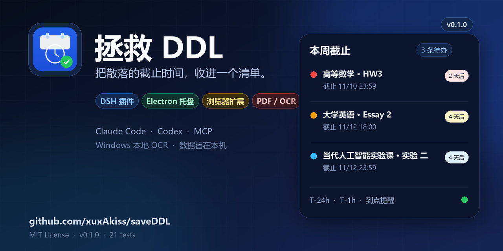
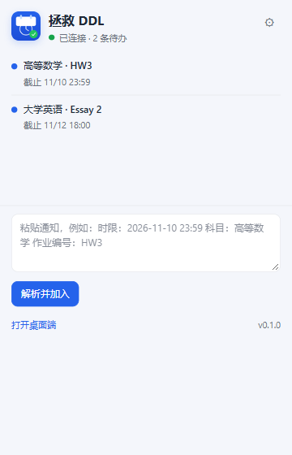
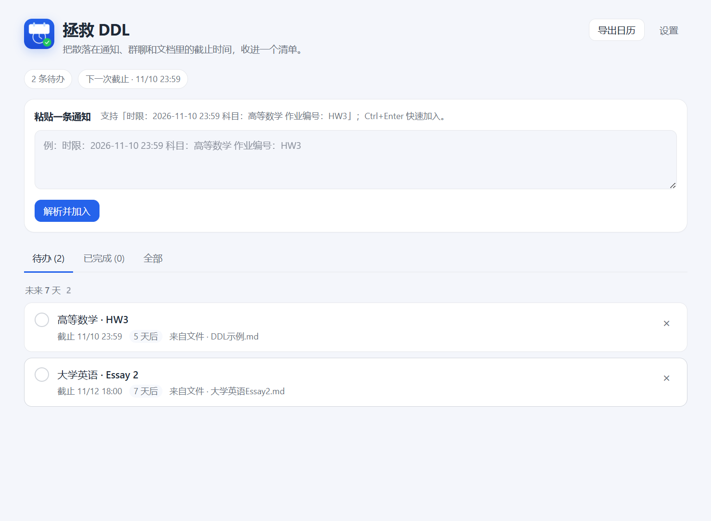
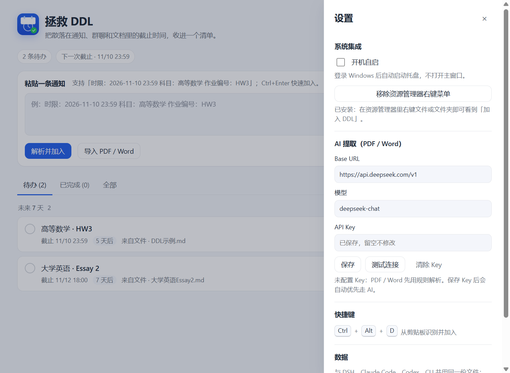
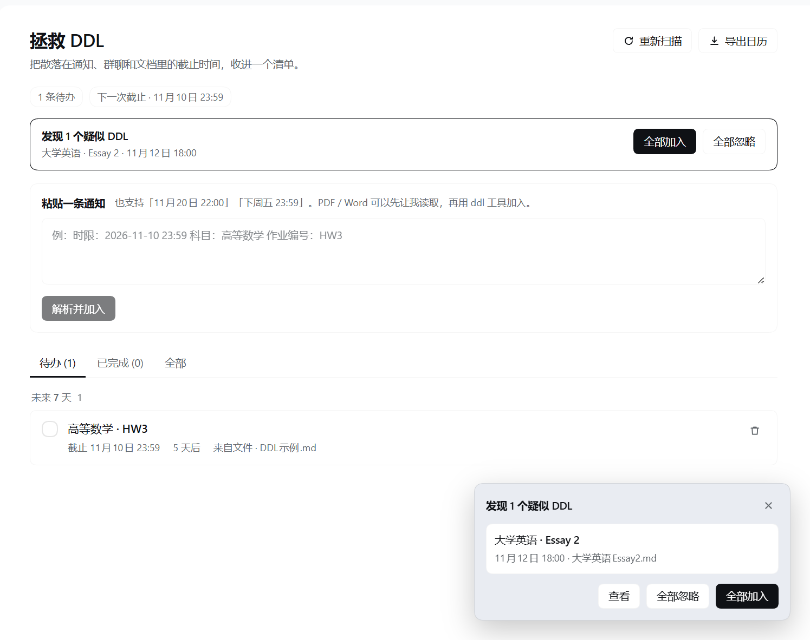

<!-- save-ddl: ignore -->
# 拯救 DDL

> 把散落在通知、群聊和文档里的截止时间，收进一个清单。

面向大学生的开源 DDL（Deadline）收集与提醒工具。目标形态是 **「右键 / 快捷键随手收集 → 系统托盘与通知栏集中查看 → 导出日历」**。本仓库当前交付 **DSH 插件 + 零依赖 MCP server / CLI**，以及一个不依赖运行时、可被后续 Electron 桌面端和浏览器扩展复用的核心解析器。

[](https://github.com/xuxAkiss/saveDDL/actions/workflows/test.yml)
[](https://github.com/xuxAkiss/saveDDL/releases)
[](LICENSE)
[](#)



## 快速开始

- **DSH 插件**：安装 `plugins/dsh-save-ddl` bundle，侧栏出现「查看 DDL」。
- **Electron 桌面端**：

  ```bash
  node apps/desktop/scripts/fetch-electron.mjs
  node apps/desktop/scripts/start.mjs
  ```

- **浏览器扩展**：`edge://extensions` → 开发人员模式 → 加载 `apps/extension`。
- **AI / OCR**：桌面端设置里填 OpenAI 兼容 Key；扫描件 / 图片用 Windows 自带 OCR。

完整步骤见下方安装章节；发布流程见 [docs/release.md](docs/release.md)。

## 当前状态

| 能力 | 状态 |
| --- | --- |
| 核心文本解析（时限 / 科目 / 作业编号） | ✅ 已完成，13 核心 + 1 MCP + 7 桌面 = 21 个测试 |
| DSH 侧栏「查看 DDL」页面 | ✅ 已完成 |
| 粘贴通知 → 解析 → 加入清单 | ✅ 已完成 |
| 扫描工作区 `.md` / `.txt`，右下角询问「是否加入」 | ✅ 已完成 |
| 完成 / 删除 / 重新扫描 / 导出 `.ics` | ✅ 已完成 |
| Agent 工具 `ddl`（add / list / complete / remove / extract） | ✅ 已完成 |
| Claude Code / Codex 通过 MCP 共用同一份清单 | ✅ Claude Code 已验证；Codex 配置已写入（重启生效） |
| CLI（list / add / add-text / done / remove / extract） | ✅ 已完成 |
| Windows 托盘 + 主窗口 | ✅ 已完成（Electron 44） |
| T-24h / T-1h / 到点系统通知 | ✅ 已完成 |
| `Ctrl+Alt+D` 从剪贴板收集 | ✅ 已完成 |
| Windows 资源管理器右键「加入 DDL」 | ✅ 已完成（HKCU，无需管理员） |
| 开机自启 | ✅ 已完成 |
| Electron 安装包 / 自动更新 | 🚧 待打包 |
| 浏览器选中文本右键「加入 DDL」 | ✅ 已完成（Edge 实测；开发者模式加载） |
| PDF / Word 的 AI 提取（用户自填 Key） | ✅ 文本型 PDF / DOCX / DOC + Windows OCR 扫描件 / 图片 |

## 现在能做什么

打开 DSH 后，左侧栏会出现 **「查看 DDL」**：

- **待办 / 已完成 / 全部** 三个视图；按「已逾期 / 今天 / 未来 7 天 / 更晚」分组。
- 顶部显示待办数、逾期数、下一次截止时间。
- 粘贴一条课程群通知或作业要求，自动解析出 **截止时间、科目、作业编号**，一键加入。
- 在工作区新建 / 修改 `.md`、`.txt` 文件后，插件会自动扫描；发现疑似 DDL 时，右下角弹出提示，可选择「全部加入 / 全部忽略 / 查看」。
- 每条 DDL 可以标记完成、恢复、删除；支持导出 `save-ddl.ics` 到系统日历。
- 在对话里可以直接说「把 11 月 10 日的高数作业加入 DDL」；模型会调用 `ddl` 工具。

### 解析示例

```text
时限：2026-11-10 23:59
科目：高等数学
作业编号：HW3
```

也支持一行写法：

```text
2026-11-10 23:59 | 高等数学 | HW3
```

以及：

- `截止时间：11 月 20 日 22:00`
- `下周五 23:59 前提交 线性代数 作业4`
- `DDL: 2026/12/1 18:00, Course: 大学英语, Assignment: Essay 2`
- 全角标点、全角数字（`２０２６－１１－１０`）

没写时间时默认当天 **23:59**；没写年份时按当前年份推断（已经过去半年以上则视为明年）。所有时间按 **本地时区** 解释。

## 安装（DSH 插件）

> 插件以本地目录 bundle 安装；装好后重启或刷新 DSH 即可。

1. 安装并启动 DeepSeek Harness。
2. 把本仓库放到任意目录，例如 `C:\Users\<你>\Documents\save-ddl`。
3. 在 DSH 中让 Agent 通过 `plugin_manager` 工具安装本地 bundle：

   ```text
   plugin_manager action=install_bundle
   target=C:\Users\<你>\Documents\save-ddl\plugins\dsh-save-ddl
   ```

   也可以在 DSH 的插件管理界面选择本地目录安装（如果当前版本支持）。
4. 安装成功后，左侧栏出现「查看 DDL」。**如果页面没有自动刷新，手动刷新一次。**

本地 bundle 是目录链接：

- 修改 `client.js` 后刷新页面即可；
- 修改 `index.js`（Host）后，需要在插件管理器里禁用再启用该 bundle，或重启 DSH；
- 修改 `packages/core/src/ddl.js` 后运行 `node scripts/sync-core.mjs`，再按上面两步生效。

### 配置

`plugins/dsh-save-ddl/cordis.patch.yml` 中可以调整：

```yaml
- insert:
    - id: save-ddl
      name: '@local/save-ddl'
      config:
        scanIntervalMs: 45000   # 两次自动扫描的最小间隔
        maxDepth: 3             # 工作区向下扫描层数
        maxFilesPerRoot: 240    # 每个工作区最多检查的文本文件数
        maxFileBytes: 262144    # 单文件最大读取字节数
        maxAgeDays: 45          # 只扫描最近多少天内修改过的文件
```

## 使用

### 1. 粘贴一条通知

打开「查看 DDL」，把通知粘进文本框，点「解析并加入」或按 `Ctrl/Cmd + Enter`。

### 2. 让工作区自动发现

仓库自带一个示例文件 [`examples/DDL示例.md`](examples/DDL示例.md)。插件扫描到它后，会在右下角提示：

> 发现 1 个疑似 DDL · 高等数学 · HW3 · 11月10日 23:59

点「全部加入」即可。

自动提示的阈值比较保守：**必须同时识别出科目和作业编号，且置信度 ≥ 0.85**，避免把普通文档里的日期误报成 DDL。识别不到的内容请用粘贴或对话兜底。

如果某个文档只是示例、不希望被扫描，在文件里加一行：

```html
<!-- save-ddl: ignore -->
```

围栏代码块（` ``` `）里的内容默认不参与扫描，因此 README 里的示例不会被误报。示例文件本身是普通正文，所以能被检测到。

### 3. 在对话里加入

```text
帮我把「大学英语 Essay 2，12 月 1 日 18:00 截止」加入 DDL。
我有哪些 DDL？这周要交什么？
```

### 4. 导出日历

点「导出日历」下载 `save-ddl.ics`，可导入 Outlook / Apple Calendar / Google Calendar。事件时间使用 UTC，日历应用会自动换算成本地时间。

## 在 Claude Code / Codex 中使用

Claude Code、Codex 和 DSH 都支持 **MCP**。仓库自带一个零依赖 MCP server（[packages/mcp-server/index.js](packages/mcp-server/index.js)）和 CLI，三者共用同一份 `ddls.json`：

```text
Claude Code ─┐
Codex ───────┼── MCP stdio ──► packages/mcp-server ──► packages/store ──► ddls.json
DSH 插件 ────┘
CLI / 脚本 ───────────────────────────────────────────────────────────────┘
```

一键配置（自动写入当前机器的绝对路径）：

```bash
# 只打印，不改配置
node scripts/setup-agents.mjs --print

# Claude Code 用户级 MCP
node scripts/setup-agents.mjs --claude
claude mcp list          # 期望看到 save-ddl: ... ✓ Connected

# Codex（追加到 ~/.codex/config.toml，先备份；重启 Codex 生效）
node scripts/setup-agents.mjs --codex
```

MCP 工具：

| 工具 | 作用 |
| --- | --- |
| `ddl_list` | 查询清单 |
| `ddl_add` | 加入一条 DDL |
| `ddl_complete` | 按 id 标记完成 |
| `ddl_remove` | 按 id 删除 |
| `ddl_extract` | 只解析文本、不落库 |

CLI：

```bash
node packages/cli/index.js list
node packages/cli/index.js add --subject 高等数学 --assignment HW3 --due "2026-11-10 23:59"
node packages/cli/index.js add-text "时限：2026-11-10 23:59 科目：高等数学 作业编号：HW3"
```

数据文件可用 `SAVE_DDL_DATA` 或 `--data <file>` 指定。完整说明、故障排查和多写者行为见 [docs/agent-integration.md](docs/agent-integration.md)。

## 浏览器扩展（Edge / Chrome）



- **选中网页文字** → 右键「加入 DDL」。
- **页面空白处** → 右键「从本页提取 DDL」（读取当前页正文，最多 20 KB）。
- **链接** → 右键「把链接加入 DDL」。
- 弹窗可查看最近待办、手动粘贴、「打开桌面端」。
- 桌面端没启动时，选中内容会暂存到扩展；图标显示角标，每分钟自动重试。
- 只申请 `http://127.0.0.1/*`，不申请 `<all_urls>`。

安装：

1. 先启动桌面端。
2. 打开 `edge://extensions` 或 `chrome://extensions`，开启「开发人员模式」。
3. 「加载解压缩的扩展」→ 选择 `apps/extension`。
4. 点扩展图标，看到「已连接 · N 条待办」即成功。

详细说明、权限与限制见 [apps/extension/README.md](apps/extension/README.md)。

## Electron 桌面端



不打开 DSH 也能用：

- **托盘**：打开清单、从剪贴板加入、暂停提醒 1 小时、开机自启、安装 / 移除右键菜单、退出。
- **主窗口**：待办 / 已完成 / 全部，逾期 / 今天 / 未来 7 天 / 更晚；粘贴解析、完成 / 恢复、删除、导出 `.ics`。
- **系统通知**：T-24h、T-1h、到点；`notified.json` 去重，重启不重复弹。
  Windows 开发版没有开始菜单快捷方式时，通知可能只进入通知中心而不弹横幅；打包安装后会正常显示。
- **`Ctrl+Alt+D`**：读取剪贴板 → 解析 → 原生确认框 → 加入。
- **资源管理器右键**：文件 / 文件夹右键「加入 DDL」；写入 HKCU，不需要管理员。
- **多 Agent 共用**：与 DSH、Claude Code、Codex、CLI 共用 `ddls.json`；文件变化后主窗口自动刷新。
- **开机自启**：设置页或托盘菜单勾选。

### PDF / Word AI 提取



不需要打开任何 AI 工具：桌面端自己提取 PDF / DOCX / DOC 文本，再调用你配置的 OpenAI 兼容接口。

1. 设置 → **AI 提取**：填 Base URL、模型、API Key。
   - 默认 `https://api.deepseek.com/v1` + `deepseek-chat`，也可换 OpenAI / 通义 / Kimi / 本地网关。
2. 点「测试连接」；成功后保存。
3. 通过以下任一入口导入：
   - 主窗口 **「导入 PDF / Word」**
   - 托盘 **「导入 PDF / Word…」**
   - 资源管理器右键文件 → 加入 DDL
   - `--add-file <path>`
4. 弹出「发现 DDL」确认框，回车加入。

- 支持 **文本型 PDF / DOCX / DOC**；`.doc` 用纯 JS 的 `word-extractor` 读取，不需要 Word。
- **扫描件 / 图片** 用 Windows 自带 OCR（`Windows.Data.Pdf` + `Windows.Media.Ocr`）识别，不需要 OCR 软件或 AI 工具；目前仅 Windows，且需要系统中文 OCR 语言包。
- 没配 Key 或 AI 失败时，自动回退规则解析，不会阻塞加入。
- Key 用 Electron `safeStorage` 加密保存在 `~/.dsh/save-ddl/ai.json`；文档文本会发送到你配置的 Base URL，设置页有提示。

开发构建提取器（改了 `src/lib/extract.js` 后）：

```powershell
cd apps/desktop
pnpm build:extract
```

生成的 `dist/extract.cjs` 会随仓库提交，普通用户运行不需要 `node_modules`。

### 运行

Electron 运行时较大（约 150 MB），不放进仓库。首次运行前自动下载到 `apps/desktop/vendor/electron`：

```powershell
node apps/desktop/scripts/fetch-electron.mjs
# 或
npm run desktop:fetch
```

然后：

```powershell
node apps/desktop/scripts/start.mjs
# 或
npm run desktop
```

Windows 上，启动脚本会把运行文件同步到 **`C:\Users\Public\SaveDDL\app`** 这个短路径再启动。原因是 Electron 对超长路径敏感：仓库如果放在很深的中文目录里，直接运行 `electron.exe` 可能崩溃。数据文件仍然在 `~/.dsh/save-ddl/ddls.json`，不会复制。

如果从 DSH 等受限父进程启动，Chromium sandbox 可能失败，设置：

```powershell
$env:SAVE_DDL_NO_SANDBOX = "1"
node apps/desktop/scripts/start.mjs
```

从资源管理器 / 桌面快捷方式正常启动时不需要这个变量。

创建桌面和开始菜单快捷方式：

```powershell
powershell -ExecutionPolicy Bypass -File apps/desktop/scripts/create-shortcut.ps1
```

### 右键菜单

在桌面端「设置 → 系统集成」里点「安装资源管理器右键菜单」。它会写入：

- `HKCU\Software\Classes\*\shell\SaveDDL`
- `HKCU\Software\Classes\Directory\shell\SaveDDL`

命令指向 `C:\Users\Public\SaveDDL\app` 下的 Electron 与 app 路径。移动仓库后重新运行 `start.mjs`，再在设置里重装一次即可。卸载用同一个按钮。

### 打包

当前是可运行的开发版，还没有 NSIS 安装包。打包计划见 [Roadmap](docs/roadmap.md) Phase 2.5；打包时会把 app 安装到 ASCII 短路径，避免上面的长路径问题。

## 数据与隐私

- 数据文件：`$DSH_HOME/save-ddl/ddls.json`。
  Windows 默认是 `C:\Users\<你>\.dsh\save-ddl\ddls.json`。
- 只在本机读写，不上传任何数据。
- HTTP API 只监听 DSH Web 服务已有的本机端口；要求同源请求，POST 还要求 `Content-Type: application/json`，第三方网页无法静默写入。
- 建议把 `ddls.json` 纳入你自己的备份 / 同步方案，但注意它可能包含课程名、作业名等信息。

## 仓库结构

```text
save-ddl/
├─ packages/
│  ├─ core/                       # 纯 JS 解析器，无运行时依赖
│  │  ├─ src/ddl.js
│  │  └─ test/ddl.test.js
│  ├─ store/                      # 共享 ddls.json 存储：文件锁 + 原子写入
│  ├─ mcp-server/                 # 零依赖 MCP stdio server
│  │  └─ test/mcp.test.js
│  └─ cli/                        # 命令行：list / add / add-text / done / remove
├─ apps/desktop/                  # Electron 托盘 + 通知 + 右键
│  ├─ src/main.js                 # 主进程：托盘、通知、快捷键、IPC、注册表
│  ├─ src/preload.cjs             # contextBridge
│  ├─ src/renderer/               # 主窗口（HTML / CSS / JS）
│  ├─ src/lib/                    # notifier / registry / ics / extract / ai / ocr / bridge
│  ├─ dist/extract.cjs            # PDF / DOCX / DOC 提取 bundle（esbuild 生成）
│  ├─ assets/                     # 图标
│  └─ scripts/                    # start / fetch-electron / ocr.ps1 / create-shortcut
├─ apps/extension/                # Edge / Chrome MV3 扩展
│  ├─ manifest.json
│  ├─ background.js               # 右键菜单、桌面桥、离线队列
│  ├─ popup.html / popup.js
│  └─ options.html / options.js
├─ plugins/dsh-save-ddl/          # DSH bundle（Host + Client）
│  ├─ index.js                    # 扫描、持久化、HTTP API、ddl 工具、系统提示
│  ├─ client.js                   # 侧栏入口、主面板、右下角提示
│  ├─ lib/core.js                 # 由 scripts/sync-core.mjs 生成
│  ├─ cordis.patch.yml
│  ├─ locale/{zh,en}.json
│  └─ icon.svg
├─ examples/                      # 两个可触发的示例
│  ├─ DDL示例.md
│  └─ 大学英语Essay2.md
├─ docs/
│  ├─ agent-integration.md        # Claude Code / Codex / CLI 接入
│  ├─ architecture.md
│  ├─ roadmap.md
│  ├─ release.md
│  ├─ desktop.png
│  ├─ extension.png
│  ├─ ai-settings.png
│  ├─ social-preview.png
│  ├─ screenshot-prompt.png
│  └─ screenshot.png
├─ scripts/
│  ├─ setup-agents.mjs            # 写入 Claude Code / Codex MCP 配置
│  └─ sync-core.mjs
├─ .github/workflows/test.yml
├─ CONTRIBUTING.md
├─ SECURITY.md
└─ package.json
```

## DSH 插件实现



### Host 半（`index.js`）

- **扫描**：只扫描当前活动会话的工作区 + 默认工作区，跳过 `node_modules`、`.git`、`dist` 等目录；按文件 mtime 缓存解析结果。
- **持久化**：`ddls.json` 采用「锁文件 + 临时文件 + rename」原子写入；DSH 在每次读状态 / 改数据前对比 mtime，自动同步 Claude Code / Codex / CLI 的写入；`accepted` / `dismissed` 签名避免重复提示。
- **HTTP API**：
  - `GET /save-ddl/state`：条目、待确认建议、扫描状态。
  - `POST /save-ddl/action`：`add` / `add-text` / `accept` / `accept-all` / `dismiss` / `dismiss-all` / `toggle` / `delete` / `clear-done` / `update` / `refresh`。
  - `GET /save-ddl/calendar.ics`：导出日历。
- **Agent 工具**：`ddl`（`list` / `add` / `complete` / `remove` / `extract`）。
- **系统提示**：告诉模型什么时候该写入 / 查询，并明确「不要编造截止时间」。

### Client 半（`client.js`）

通过 Cordis 的 slot 机制注册三个入口：

| Slot | 注册方式 | 作用 |
| --- | --- | --- |
| `main` | `key: 'save-ddl'` | 主面板「查看 DDL」 |
| `sidebar.panellist` | `id: 'save-ddl'` | 左侧栏图标 + 「查看 DDL」标签 |
| `shell.overlay` | `id: 'save-ddl-suggestions'` | 右下角「是否加入」提示 |

数据通过同源 `fetch` 读取，页面每 5 秒轮询一次；页面和提示层共用一个 store，避免重复请求。样式只使用 `--dsw-alias-*` 主题 token，跟随 DSH 的明暗主题。

## 已知限制

- 只直接读取 `.md` / `.markdown` / `.txt` / `.text` / `.rst`。PDF、Word、扫描件不在 Host 里解析，避免引入重依赖和 API Key。
- 只扫描「当前活动会话的工作区 + 默认工作区」，不会扫描历史所有工作区。
- 规则解析一定会有漏报 / 误报；自动提示要求科目 + 作业编号，手动粘贴和 Agent 工具作为兜底。
- 多 Agent 同时写 `ddls.json` 时以最后一次写入为准；已加文件锁、mtime 合并和 `.bak` 备份，但这不是分布式事务。
- Codex 的 MCP 配置修改后需要重启 Codex；Claude Code 以 `claude mcp get save-ddl` 的 Connected 状态为准。
- 浏览器扩展需要桌面端运行；当前是开发者模式加载，未上架扩展商店。
- PDF / Word AI 提取覆盖文本型 PDF / DOCX / DOC + Windows OCR 扫描件 / 图片；OCR 目前仅 Windows。
- AI 需要用户自己的 OpenAI 兼容 Key；文档文本会发送到配置的 Base URL。
- NSIS 安装包 / 自动更新还没做。
- DSH 面板轮询间隔 5 秒；桌面端用 `fs.watchFile` 监听数据文件。

## 开发

需要 Node.js ≥ 20（开发时使用的是 DSH 自带的 Node 24）。

```bash
# 全部测试（核心 / MCP / 桌面端）
node --test

# 运行桌面端
node apps/desktop/scripts/start.mjs

# 修改核心解析器后，同步到 DSH 插件
node scripts/sync-core.mjs
```

### 新增解析规则

1. 在 `packages/core/src/ddl.js` 增加模式。
2. 在 `packages/core/test/ddl.test.js` 补测试，固定 `now` 避免相对日期漂移。
3. `node --test` 全绿。
4. `node scripts/sync-core.mjs`。
5. 刷新 DSH 页面 / 重启 Host 插件。

## Roadmap

按「先能让大学生今天用起来，再补齐系统级入口」的顺序推进：

0. **Agent 兼容**：MCP server + CLI，Claude Code / Codex / DSH 共用清单（已完成）。
1. **Electron 托盘 MVP**：托盘、系统通知、`Ctrl+Alt+D`、资源管理器右键、开机自启（已完成；安装包待做）。
2. **浏览器扩展**：MV3 `contextMenus` 支持选中文本 / 页面 / 链接右键加入（已完成）。
3. **AI 提取 + Windows OCR**：OpenAI 兼容接口 + 用户自填 Key；文本型 PDF / DOCX / DOC + 扫描件 / 图片 OCR（已完成）。
4. **提醒与同步**：T-24h / T-1h 通知、免打扰、ICS 导入 / 导出、可选 WebDAV 同步。

详见 [docs/roadmap.md](docs/roadmap.md)；架构与数据流见 [docs/architecture.md](docs/architecture.md)；发布流程见 [docs/release.md](docs/release.md)。

## 贡献

欢迎 Issue / PR，先看 [CONTRIBUTING.md](CONTRIBUTING.md)。优先欢迎：

- 更多中文教务通知格式的解析样本（脱敏后）；
- 新的日期 / 作业编号写法与对应测试；
- Claude Code / Codex 集成、MCP 工具描述改进；
- Electron / 浏览器扩展的实现；
- 主题、可访问性、移动端适配改进。

提交解析规则时请附带测试用例，并避免把真实姓名、学号、课程群链接写进仓库。安全问题请按 [SECURITY.md](SECURITY.md) 私下报告。

## License

[MIT](LICENSE)