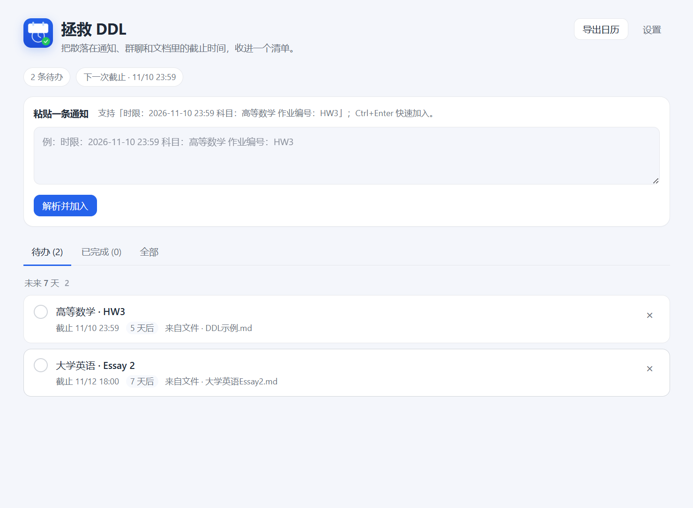

# 拯救 DDL · Electron 桌面端

托盘、系统通知、`Ctrl+Alt+D` 和 Windows 资源管理器右键。数据与 DSH 插件、Claude Code、Codex、CLI 共用同一份 `ddls.json`。



## 运行

Electron 运行时约 150 MB，不放进仓库。首次运行前自动下载到 `vendor/electron`：

```powershell
node scripts/fetch-electron.mjs
```

然后从仓库根目录：

```powershell
node apps/desktop/scripts/start.mjs
```

或者从本目录：

```powershell
node scripts/start.mjs
```

## 为什么要同步到 `C:\Users\Public\SaveDDL\app`

Electron 对超长路径敏感。如果仓库放在类似：

```text
C:\Users\<你>\Documents\deepseek-harness\default-workspace\save-ddl\apps\desktop\...
```

直接运行 `electron.exe` 可能崩溃（0xC0000005）。启动脚本会把 `apps`、`packages` 和 `vendor` 同步到短路径 `C:\Users\Public\SaveDDL\app`，再从那里启动。数据文件仍然在 `~/.dsh/save-ddl/ddls.json`。

- 修改源码后重新运行 `start.mjs` 即可同步并启动。**修改主进程后先从托盘退出**，否则单实例锁会让新进程直接退出，旧进程仍在用旧代码。
- 移动仓库后重新运行，右键菜单/开机自启会指向新的运行路径；需要重新安装一次右键菜单。
- 可用 `SAVE_DDL_RUNTIME` 指定别的短路径。

## 从 DSH 等受限父进程启动

Chromium sandbox 在部分受限父进程中会失败。此时：

```powershell
$env:SAVE_DDL_NO_SANDBOX = "1"
node scripts/start.mjs
```

从资源管理器或桌面快捷方式正常启动时不需要。

创建桌面 / 开始菜单快捷方式：

```powershell
powershell -ExecutionPolicy Bypass -File scripts/create-shortcut.ps1
```

## 功能

- 托盘菜单：打开清单、从剪贴板加入、暂停提醒 1 小时、开机自启、安装 / 移除右键菜单、退出。
- 系统通知：T-24h、T-1h、到点；去重记录在 `~/.dsh/save-ddl/notified.json`。
  Windows 开发版没有开始菜单快捷方式时，通知可能只进入通知中心而不弹横幅；打包安装后会正常显示。
- `Ctrl+Alt+D`：读剪贴板 → 解析 → 原生确认框 → 加入。
- 资源管理器右键「加入 DDL」：写入 HKCU，无需管理员。
- 主窗口：粘贴解析、完成 / 恢复、删除、导出 `.ics`。
- PDF / Word AI 提取：设置页配置 OpenAI 兼容接口；主窗口 / 托盘 / 右键 / `--add-file` 导入，自动提取文本并调用 AI，失败回退规则。扫描件 / 图片走 Windows OCR。
- 文件监听：其他 Agent 写入 `ddls.json` 后自动刷新列表。

## PDF / Word AI 提取

- 支持文本型 `.pdf`、`.docx`、`.doc`；`.doc` 用纯 JS `word-extractor` 读取，不需要 Word / LibreOffice。
- 扫描件 PDF / 图片用 Windows 自带 OCR（`Windows.Data.Pdf` + `Windows.Media.Ocr`），不需要外部 OCR / AI 工具；目前仅 Windows，需要中文 OCR 语言包。
- 设置 → AI 提取：Base URL / 模型 / API Key，点「测试连接」。
- 默认 `https://api.deepseek.com/v1` + `deepseek-chat`。
- Key 用 `safeStorage` 加密到 `~/.dsh/save-ddl/ai.json`；文档文本会发送到 Base URL。
- 提取器由 `unpdf` + `mammoth` 打包为 `dist/extract.cjs`：

  ```powershell
  pnpm build:extract
  ```

  普通运行不需要 `node_modules`；改 `src/lib/extract.js` 后重新构建。

## 数据

与 DSH / Claude Code / Codex / CLI 共用：

```text
C:\Users\<你>\.dsh\save-ddl\ddls.json
```

每次写入前会备份到 `ddls.json.bak`。

## 打包（待办）

当前是可运行的开发版。后续用 electron-builder 打 NSIS，把应用安装到 ASCII 短路径（如 `C:\Program Files\SaveDDL`），并加入开机自启、自动更新和代码签名。