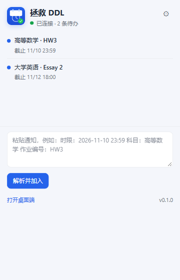

# 拯救 DDL · 浏览器扩展（MV3）

选中网页文字 → 右键 **加入 DDL**。数据由桌面端写入共享的 `ddls.json`，与 DSH / Claude Code / Codex / CLI 同一份。



## 安装（Edge / Chrome，开发者模式）

1. 先启动桌面端（扩展需要本地桥）：

   ```powershell
   $env:SAVE_DDL_NO_SANDBOX = "1"
   node apps/desktop/scripts/start.mjs
   ```

2. 打开 `edge://extensions` 或 `chrome://extensions`。
3. 打开「开发人员模式」。
4. 点「加载解压缩的扩展」，选择本目录：

   ```text
   save-ddl\apps\extension
   ```

5. 点扩展图标，看到 **“已连接 · N 条待办”** 即成功。

> Edge 156 实测通过。Chrome 156 在命令行 `--load-extension` 下可能被策略忽略；用上面的手动「加载解压缩的扩展」即可。

## 使用

- **选中文字** → 右键「加入 DDL」：最常用。
- **页面空白处** → 右键「从本页提取 DDL」：读取页面正文（最多 20 KB），解析后加入。
- **链接** → 右键「把链接加入 DDL」：把链接文字 + URL 作为文本发送。

弹窗里也可以直接粘贴通知、手动加入；「打开桌面端」会唤起桌面窗口。

## 桌面端桥

扩展访问：

```text
http://127.0.0.1:17893/health
http://127.0.0.1:17893/items
http://127.0.0.1:17893/add-text
http://127.0.0.1:17893/show
```

- 端口从 17893 起，桌面端被占用时会自动往后找；扩展会扫描 17893–17903。
- 默认 token：`save-ddl-local-v1`，可在扩展设置和桌面端代码里对齐。
- 只监听 `127.0.0.1`，并检查 `Origin` 为 `chrome-extension://` / 本地。
- `host_permissions` 只给了 `http://127.0.0.1/*`，没有申请 `<all_urls>`。

## 桌面端未启动

选中的文字会先存进 `chrome.storage.local`：

- 扩展图标显示红色角标，弹窗显示「已暂存 N 条」。
- 每分钟自动重试；也可以点「重试」。
- 桌面端启动后，暂存内容会写入 `ddls.json`。

## 权限说明

| 权限 | 用途 |
| --- | --- |
| `contextMenus` | 右键菜单 |
| `storage` | 端口 / token / 离线暂存 |
| `notifications` | 加入成功 / 失败反馈 |
| `scripting`, `activeTab` | 只在用户点「从本页提取」时读取当前页正文 |
| `alarms` | 每分钟重试暂存 |
| `host_permissions: http://127.0.0.1/*` | 访问本地桌面桥 |

没有申请 `<all_urls>`，不会后台读取所有网页。

## 已知限制

- 解析在桌面端完成；扩展本身不打包 `@save-ddl/core`，以减少重复逻辑。
- 桌面端必须运行，否则只能暂存。
- 页面正文提取依赖 `activeTab`；某些 `chrome://` / 扩展商店页面不允许注入。
- 暂未上架 Chrome Web Store / Edge Add-ons；当前是开发者模式加载。
- 暂不支持 Firefox（`browser.*` 的 contextMenus 差异后续处理）。

## 开发

改完 `background.js` / `popup.*` 后，在扩展管理页点「重新加载」，再刷新页面。桌面桥代码在 [apps/desktop/src/lib/bridge.js](../desktop/src/lib/bridge.js)。