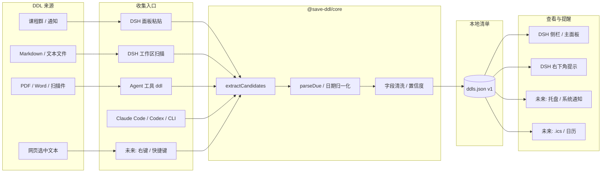
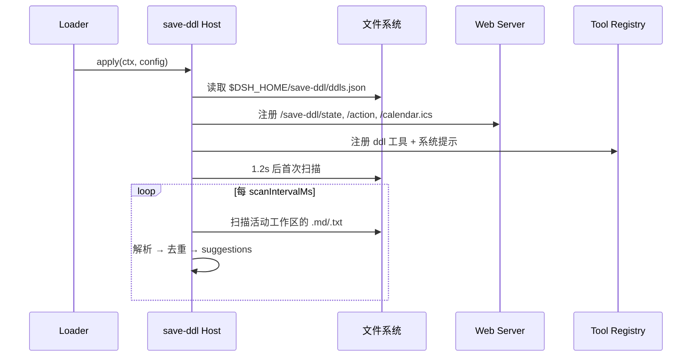
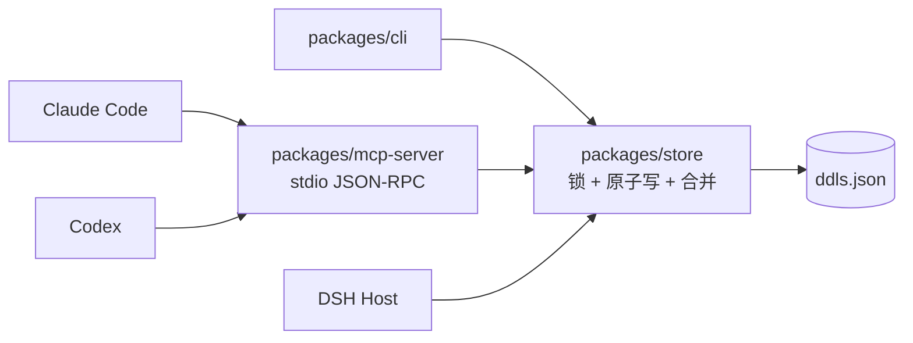
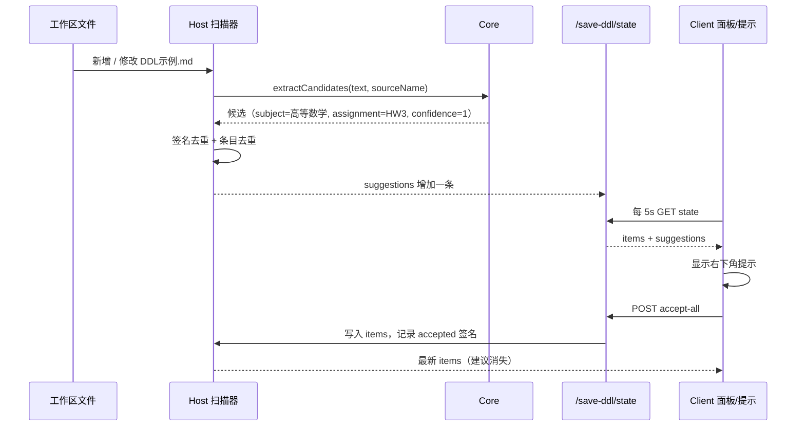
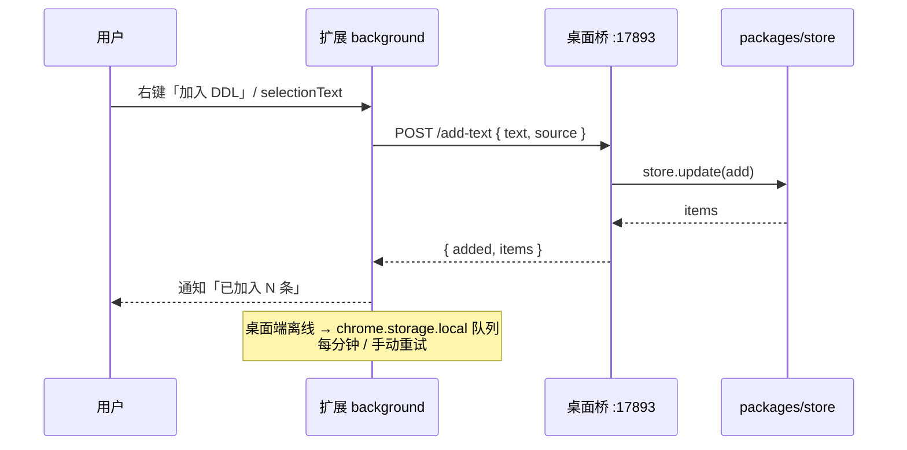

<!-- save-ddl: ignore -->
# 架构说明

## 1. 设计目标

1. **随手收集**：看到 DDL 的那一刻就能加入，不要求打开一个独立 App 再手填表单。
2. **一处查看**：不管来源是通知、群聊、Markdown、PDF 还是 Word，最后都进入同一份清单。
3. **本地优先**：默认不联网、不上传；AI 提取也必须由用户显式配置 Key。
4. **可复用**：同一套解析器 / 数据格式服务于 DSH 插件、Electron 桌面端和浏览器扩展，避免三套逻辑。
5. **可降级**：AI 不可用时，规则解析 + 手动粘贴仍然可用。

## 2. 总览



核心原则：**入口只负责拿到文本，解析器只负责把文本变成结构化候选，存储只负责一份清单。**

## 3. 模块职责

### 3.1 `packages/core`：纯函数解析器

- 不依赖 Node / DOM / 网络，ESM，浏览器和 Node 都能直接 `import`。
- 输入：任意文本 + `now` + `sourceName`。
- 输出：`{ subject, assignment, dueAt, title, confidence, snippet, matched, sourceName }[]`。
- 只做「启发式提取」；不负责持久化、提醒、UI。
- 关键导出：
  - `extractCandidates(text, options)`：提取多条候选。
  - `parseDdlText(text, options)`：只取最可信的一条。
  - `parseDue(text, now)`：单独的截止时间解析。
  - `looksLikeDdl(text)`、`formatTitle`、`formatDue`、`normalizeText`。

日期解析顺序：

1. `2026-11-10` / `2026/11/10` / `2026.11.10`（可带 `23:59`）
2. `2026 年 11 月 10 日`
3. `11 月 10 日`（按当前年份推断；过去半年以上视为明年）
4. `今天 / 明天 / 后天 / 大后天`
5. `周五 / 本周五 / 下周五 / 下下周五`
6. `N 天后`

同一段文本里的多个日期会按「距离截止关键词的远近」打分，取最可信的一个；多个空行分隔的段落会分别解析，从而支持一次粘贴多条 DDL。

字段窗口：每个 anchor 取前 3 行 / 后 8 行（或到下一个 anchor），**不会把 anchor 之后的整篇文档当成字段区**；标题行 `课程名：实验二` 会优先取冒号左侧作为 subject，并保留「实验课」不被误削。这是修复「实验 PDF 被识别成叶子节点」的关键。

### 3.2 `plugins/dsh-save-ddl`：DSH bundle

一个 bundle 同时包含 Host 和 Client：

```text
cordis.patch.yml
  └─ insert: save-ddl → @local/save-ddl
       ├─ index.js   (Host)
       └─ client.js  (Web Client, dsh.client)
```

#### Host 生命周期



扫描范围：

- `workingDirectory.defaultDirectory`；
- `ctx.agents.list()` 中每个活动 Agent 的会话目录（优先 `workingDirectory.get(session)`，回退 `ensure(agent)`）；
- 去重后最多 8 个根目录。

跳过的目录：`node_modules`、`dist`、`build`、`out`、`coverage`、`vendor`、`target`、`release`、`generated`、`__pycache__`、`_tmp`、`venv`、`.venv`，以及所有以 `.` 开头的目录。

避免误报的三道闸：

1. 只接受扩展名 `.md` / `.markdown` / `.txt` / `.text` / `.rst`；
2. 只接受最近 `maxAgeDays` 天内修改过的文件；
3. 自动建议必须 **有作业编号且置信度 ≥ 0.85**。

`fileCache` 以 `mtimeMs:size` 为 key，文件没改就不重复读 / 重复解析。

#### 持久化

`ddls.json` v1：

```json
{
  "version": 1,
  "items": [
    {
      "id": "uuid",
      "subject": "高等数学",
      "assignment": "HW3",
      "title": "高等数学 · HW3",
      "dueAt": "2026-11-10T15:59:00.000Z",
      "status": "todo",
      "notes": "",
      "source": { "kind": "file", "path": "...", "name": "DDL示例.md" },
      "createdAt": "2026-11-05T06:16:28.401Z",
      "updatedAt": "2026-11-05T06:16:57.681Z"
    }
  ],
  "dismissed": ["sha1..."],
  "accepted": ["sha1..."],
  "updatedAt": "..."
}
```

- `dueAt` 一律 ISO 8601 UTC；展示时转本地时区。
- `accepted` / `dismissed` 是「文件路径 + mtime + 候选字段」的签名，文件没变就不会再次提示。
- 写入使用 `临时文件 + rename`，避免半截 JSON。
- 只保留最近 500 个签名，避免无限增长。

#### HTTP API

| 方法 | 路径 | 说明 |
| --- | --- | --- |
| GET | `/save-ddl/state` | `{ ok, items, suggestions, scannedAt, scanning, roots }` |
| POST | `/save-ddl/action` | 见下表 |
| GET | `/save-ddl/calendar.ics` | 导出未完成条目的 VCALENDAR |

`action` 取值：

- `add` / `add-text`：加入；`add-text` 会先走解析器。
- `accept` / `accept-all` / `dismiss` / `dismiss-all`：处理建议。
- `toggle` / `delete` / `clear-done` / `update`：维护条目。
- `refresh`：强制重新扫描（最多约 6 秒）。

所有响应都包含最新的 `items` 和 `suggestions`，客户端一次请求即可刷新整个 store。

安全约束：

- 只接受同源请求（比较 `Origin` 与 `Host`）；
- POST 必须 `Content-Type: application/json`，跨站表单无法直接写入；
- 请求体上限 256 KB；
- 响应 `Cache-Control: no-store`。

#### Agent 工具与提示

`ddl` 工具：

| action | 参数 | 作用 |
| --- | --- | --- |
| `list` | `includeDone?` | 查询清单 |
| `add` | `subject` / `assignment` / `dueAt` / `title?` / `notes?` | 加入 |
| `complete` | `id` | 标记完成 |
| `remove` | `id` | 删除 |
| `extract` | `text` | 只解析、不落库 |

系统提示只写「什么时候用」，不写死业务数据；日期不明确时要求模型先问用户，禁止编造。

#### Client 入口

| Slot | 注册 | 说明 |
| --- | --- | --- |
| `main` | `key: 'save-ddl'` | 主面板；与侧栏 id 对应 |
| `sidebar.panellist` | `id: 'save-ddl'`, `order: 20` | 侧栏图标 + 「查看 DDL」标签 |
| `shell.overlay` | `id: 'save-ddl-suggestions'` | 右下角建议提示 |

客户端只有一个 `createDdlStore()`，页面和提示层通过 `useSyncExternalStore` 共用快照；5 秒轮询一次，窗口重新获得焦点时立即刷新。样式全部使用 `--dsw-alias-*` token；文案通过 `ctx.locale` 注册中英文字典。

### 3.3 Agent 兼容层：`packages/store` / `packages/mcp-server` / `packages/cli`

Claude Code、Codex 和 DSH 都支持 MCP，所以不需要为每个 Agent 重写插件：



- `packages/store`：MCP / CLI 共用的文件存储。`ddls.json.lock` 独占创建，`wx` 模式；写临时文件后 `rename`；读不到文件时重试 3 次，避免 Windows rename 瞬间的 ENOENT。
- `packages/mcp-server`：零依赖 stdio MCP server，暴露 5 个工具；只写 stderr 日志。
- `packages/cli`：给不接 MCP 的 Agent / 脚本使用；与 MCP 共用 store。
- `scripts/setup-agents.mjs`：把 Node 绝对路径、MCP server 路径、`SAVE_DDL_DATA` 写入 Claude Code 用户配置 / Codex `config.toml`；Codex 先备份。
- DSH Host：每次 `/state`、修改、扫描前 `stat` 数据文件；mtime 变化就重新加载。写回时在锁内合并磁盘上「自己没见过的」条目；删除的 id 记录在 `deletedIds`，不会被合并复活。

多写者不是分布式事务：两个进程在毫秒级同时写时仍以最后一次写入为准。个人单机场景下，锁 + mtime 合并已经覆盖「DSH 面板、Claude Code、Codex、CLI 交替操作」的常见路径。

## 4. 数据流：一次「工作区发现」



## 5. Electron 桌面端（MVP 已实现）

技术选型：**Electron 44.7.0 + ESM JavaScript**。MVP 先用纯 JS 跑通托盘 / 通知 / 右键，避免引入构建链；打包阶段可以再迁移 TypeScript。

```text
apps/desktop/
├─ src/main.js          # 主进程：窗口、托盘、通知、快捷键、IPC、注册表
├─ src/preload.cjs      # contextBridge，只暴露白名单 API
├─ src/renderer/        # index.html / app.js / styles.css
├─ src/lib/notifier.js  # T-24h / T-1h / 到点通知 + notified.json 去重
├─ src/lib/registry.js  # HKCU 右键菜单安装 / 卸载
├─ src/lib/ics.js       # .ics 导出
└─ scripts/start.mjs    # 同步到短路径并启动 Electron
```

Windows 上 `start.mjs` 会把运行文件同步到 `C:\Users\Public\SaveDDL\app` 再启动：Electron 对超长路径敏感，仓库放在很深的中文目录里直接运行会崩溃（0xC0000005）。数据文件仍在 `~/.dsh/save-ddl`。

### 5.1 系统托盘与通知

- `Tray` 菜单：打开清单、从剪贴板加入、暂停提醒 1 小时、开机自启、安装 / 移除右键菜单、退出。
- 通知调度：每分钟检查一次；剩余 12–24 小时发「还有约 24 小时」，剩余 0–1 小时发「还有约 1 小时 / 不到 30 分钟」，到点后 1 小时内发「已到截止时间」。
- 去重键 `${id}:${dueAt}:${rule}` 写入 `~/.dsh/save-ddl/notified.json`，重启不重复弹。
- 点击通知聚焦窗口并定位到该条目。
- 托盘 tooltip 目前固定为「拯救 DDL」；“最近一条”留作后续。

### 5.2 右键与快捷键

系统级「右键选中文本 → 加入 DDL」在 Windows 上没有通用 API，实际拆成三个入口：

1. **资源管理器右键文件（已实现）**：
   写入 `HKCU\Software\Classes\*\shell\SaveDDL`，目录用 `Directory\shell\SaveDDL`。
   开发态命令是 `"electron.exe" "<appPath>" --add-file "%1"`，打包后是 `"Save DDL.exe" --add-file "%1"`。
   静态菜单，不需要 shell extension DLL，卸载时删除键即可。
2. **任意应用选中文本（已实现）**：
   全局快捷键 `Ctrl+Alt+D`：读取剪贴板 → 解析 → 原生确认框 → 加入；默认不改剪贴板内容。
3. **浏览器选中文本（后续）**：
   MV3 扩展的 `chrome.contextMenus` 支持 `contexts: ['selection', 'page', 'link']`，这是最接近「右键文本 → 加入DDL」的体验。

`--add-file` 解析要特别注意：Electron 可能在 `--add-file` 和文件路径之间插入 `--allow-file-access-from-files`、`--source-app-id` 等 Chromium 开关，因此实现取「最后一个非 flag 参数」，而不是 `argv[index + 1]`。

### 5.3 文件与 AI 提取（已实现）

```text
文件 → 按扩展名分流
  ├─ .md/.txt/.rst  → 直接读文本 → core
  ├─ .pdf           → unpdf 提取文本 → AI（配置了 Key）→ core 兜底
  │                    └─ 文本为空 → Windows OCR
  ├─ .docx          → mammoth 提取文本 → AI（配置了 Key）→ core 兜底
  ├─ .doc           → word-extractor（纯 JS，OLE）→ AI → core 兜底
  └─ .png/.jpg/...  → Windows OCR → AI / core
```

实现：

- [`src/lib/extract.js`](../apps/desktop/src/lib/extract.js)：`unpdf` + `mammoth` + `word-extractor`，用 esbuild 打包成 `apps/desktop/dist/extract.cjs`（约 2 MB）；主进程通过 `createRequire` 加载，运行时不依赖 `node_modules`。
- [`src/lib/ocr.js`](../apps/desktop/src/lib/ocr.js) + [`scripts/ocr.ps1`](../apps/desktop/scripts/ocr.ps1)：Windows 自带 `Windows.Data.Pdf` 渲染页面 + `Windows.Media.Ocr` 识别，不引入 Tesseract / 外部 AI；OCR 结果会折叠汉字间空格，例如 `提 交 截 止 日 期` → `提交截止日期`。
- [`src/lib/ai.js`](../apps/desktop/src/lib/ai.js)：OpenAI 兼容 `/chat/completions`，默认 `https://api.deepseek.com/v1` + `deepseek-chat`。
- AI 设置：`baseUrl` / `model` / `apiKey`；Key 用 `safeStorage` 加密后写入 `~/.dsh/save-ddl/ai.json`（不可用时才回退明文），不写日志。
- Prompt 额外传入 **文件名 + 文档开头 800 字** 作为 course hint，并明确禁止把 `叶子节点 / TreeNode / children / value / A* / alpha-beta / 队列` 等代码术语当成 subject。
- AI 返回后还会校验 subject；命中可疑代码词就丢弃 AI 结果、回退 core 规则，避免「叶子节点 · 实验二」这类错误。
- Prompt 要求严格 JSON：

  ```json
  { "items": [{ "subject": "", "assignment": "", "dueAt": "ISO8601", "confidence": 0.0 }] }
  ```

- 有 Key 时先走 AI；AI 返回空 / 请求失败 / 结果可疑时回退 core 规则解析，绝不阻塞加入。
- 入口：主窗口「导入 PDF / Word」、托盘「导入 PDF / Word…」、资源管理器右键文件、`--add-file`。
- 发送前在设置页提示：文档文本会发送到配置的 Base URL。

### 5.4 本地 API 与浏览器扩展

桌面端通过 [bridge.js](../apps/desktop/src/lib/bridge.js) 启动本地 HTTP 桥：

- 只监听 `127.0.0.1`，端口从 `17893` 开始尝试（最多 11 个），扩展扫描 `17893–17903`。
- 固定 token `save-ddl-local-v1`，放在 `x-save-ddl-token` 请求头；扩展设置页可修改。
- 只接受 `chrome-extension://` 或本地 Origin；`OPTIONS` 仅对扩展 Origin 回 CORS。
- 端点：`GET /health`、`GET /items`、`POST /add-text`、`POST /show`。
- 扩展只发送 `{ text, source: { url, title } }`，不发送整页 HTML；解析在桌面端复用 `@save-ddl/core`。
- 不需要 Native Messaging，便于开发者模式加载和调试。

### 5.5 存储演进

- v1：`ddls.json`（当前 DSH 插件已在用）。
- Electron 首版继续读同一份文件，避免迁移；写入前做 schema 校验。
- 当条目 > 1000 或需要全文搜索时迁移到 SQLite（`better-sqlite3`），提供一次性 `v1 → v2` 迁移。
- 保留 `export/import JSON` 作为跨设备迁移的兜底。

## 6. 浏览器扩展（MVP 已实现）

```text
apps/extension/
├─ manifest.json        # MV3
├─ background.js        # contextMenus + 本地桥 + 离线队列 + 通知
├─ popup.html / .js     # 最近待办 + 手动粘贴 + 打开桌面端
├─ options.html / .js   # 端口 / token / 测试连接
└─ icons/
```

右键菜单：

- `selection`：选中文本 → 「加入 DDL」；
- `page`：整页正文（`document.body.innerText`，截断 20 KB）→ 「从本页提取 DDL」；
- `link`：链接文字 + URL。

数据流：



权限最小化：`contextMenus`、`storage`、`notifications`、`scripting`、`activeTab`、`alarms`；`host_permissions` 只有 `http://127.0.0.1/*`，不申请 `<all_urls>`。

Chrome 156 在命令行 `--load-extension` 下可能不加载 unpacked 扩展；Edge 156 实测可以，Chrome 用开发者模式手动「加载解压缩的扩展」即可。

## 7. 测试策略

| 层 | 方式 |
| --- | --- |
| Core | `node --test`，固定 `now`，覆盖中英文 / 全角 / 相对日期 / 多条目 / 表格 |
| Host | HTTP API 冒烟：state、add-text、toggle、delete、calendar |
| Client | 在 DSH 页面里用 CDP 检查 slot 渲染、点击流程；截图核对主题 |
| Electron | CDP 检查窗口和 IPC 流程；注册表命令用 `reg query`；通知看 `notified.json` |
| 本地桥 | `curl /health`、`POST /add-text`、离线后重试 |
| 扩展 | Edge 156 加载 unpacked → CDP 检查 popup / service worker；`chrome.contextMenus.update` 验证菜单注册 |

## 8. 关键取舍

- **为什么用 HTTP 而不是自定义 Remote**：DSH 的自定义 Remote 需要 Typert 生成 schema；同源 HTTP 路由更小、更容易被未来 Electron / 扩展复用。代价是 5 秒轮询而不是推送。
- **为什么自动提示要求「科目 + 作业编号」**：只靠日期会把 README、CHANGELOG 里的历史日期误报成 DDL；宁可漏报，让用户手动粘贴兜底。
- **为什么不把 AI 放进 DSH 插件**：DSH 会话本身就是模型，重复接一套 Key 管理没有收益；桌面端才需要独立的 AI 设置。
- **为什么数据用 JSON 而不是数据库**：单用户、条目少、需要被多个进程读取；JSON 足够，且易备份 / 调试。规模上来再迁移。